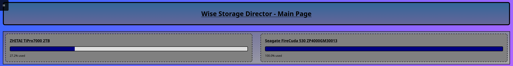
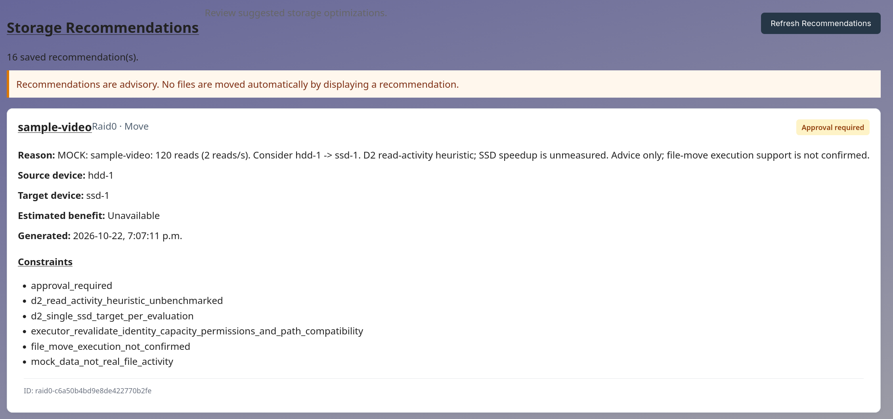
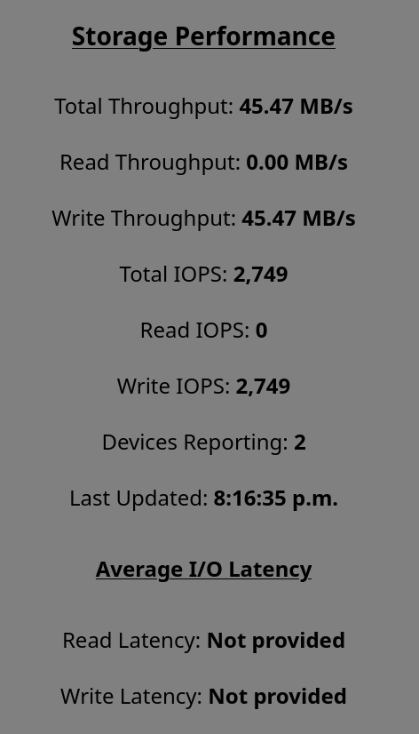
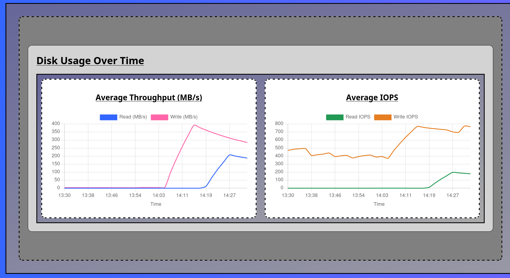
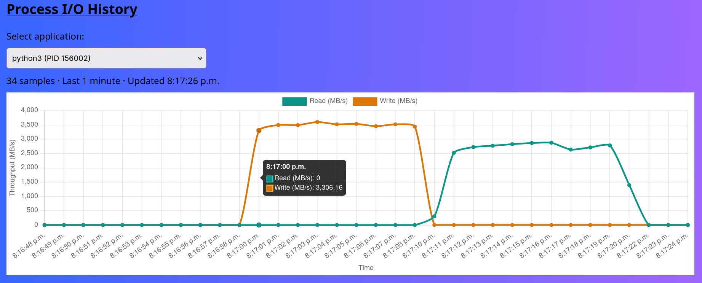
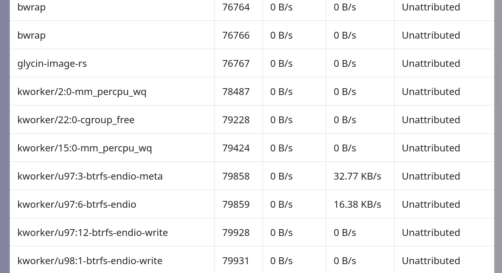

# Wise Storage Director (WSD) — Frontend Grading Walkthrough

This guide is for TAs reviewing the **frontend features** of WSD. Use the **☰ menu** to switch between views. The example values in the screenshots are illustrative; actual numbers depend on the computer's current disk activity.

## 1. Disk Recognition — Main Page

1. Open **Main Page**.
2. Check that each card shows the **drive name/model**, a **storage usage bar**, and the **percentage of capacity used**.

## 2. Storage Recommendations

Swipe down on the main page to inspect advisory suggestions, including the reason, source/target device, and constraints. The example shown uses **mock data**. Recommendations **do not automatically move files**; this screen is separate from the five I/O-monitoring features above.

## 3. Disk Real-Time I/O — Storage Performance

1. Click on ≡ sign on top left and choose Disk Usage Statistics
2. Observe **Total, Read, and Write Throughput (MB/s)** and **Total, Read, and Write IOPS**.
3. Check **Devices Reporting** and **Last Updated** to confirm the source count and that the readings update.
4. Perform a disk read or write (such as copying a file), then observe the corresponding activity on this page.

## 4. Disk Historical Average I/O — Disk Usage Over Time

1. View the two historical graphs:
   - **Average Throughput (MB/s):** read and write transfer rates over time.
   - **Average IOPS:** read and write operations per second over time.

## 5. Process Real-Time I/O — Process Table

1. Find running applications by their **process name** and **PID**.
2. Generate I/O in a running application and look for its updated values in the table.

## 6. Process Historical I/O — Process I/O History

1. Shows all running processes on the computer, and their PID, name, and IO on the right (Updated Real time)

