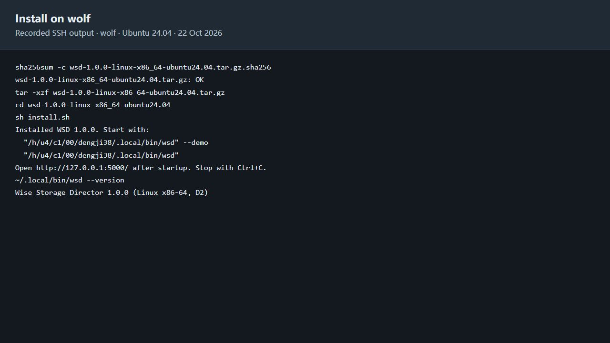
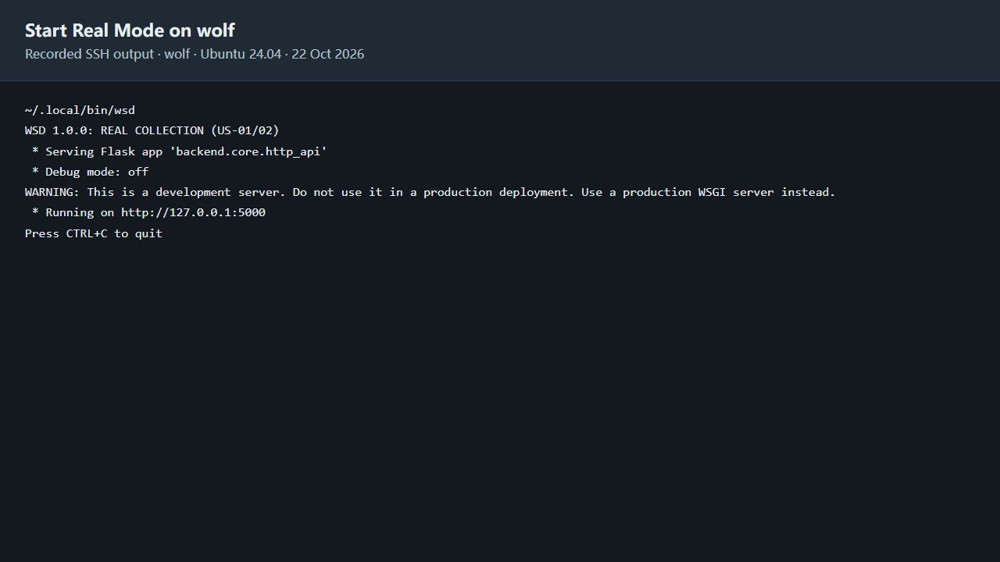

# WSD for Linux

For x86 Linux.

## Install

Extract the downloaded package, then install:

```sh
tar -xzf wsd-1.0.0-linux-x86_64-ubuntu24.04.tar.gz
cd wsd-1.0.0-linux-x86_64-ubuntu24.04
sh install.sh
```

After installation:



## Run

Monitor real disk and process activity:

```sh
~/.local/bin/wsd
```



Or try recommendations using sample data:

```sh
~/.local/bin/wsd --demo
```

On the Linux machine, open http://127.0.0.1:5000/.
Press Ctrl+C to stop before switching modes.

## Frontend walkthrough

See the [frontend walkthrough](../../deliverables/D2/WSD_TA_Frontend_Walkthrough.md)
for the dashboard, recommendations, disk activity and process history.

## Access from another computer

Connect to the Linux machine with port forwarding:

```sh
ssh -L 5500:127.0.0.1:5000 user@host
```

Start WSD in that SSH session. Keep the session open, then visit
http://127.0.0.1:5500/ on your own computer.
