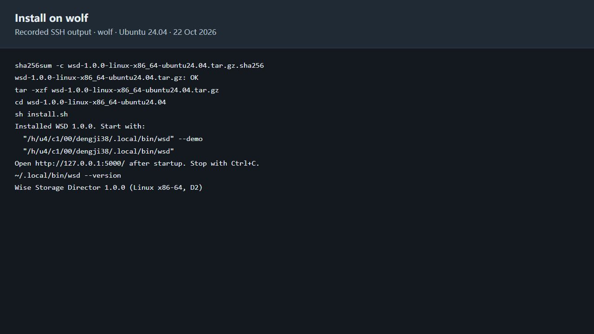
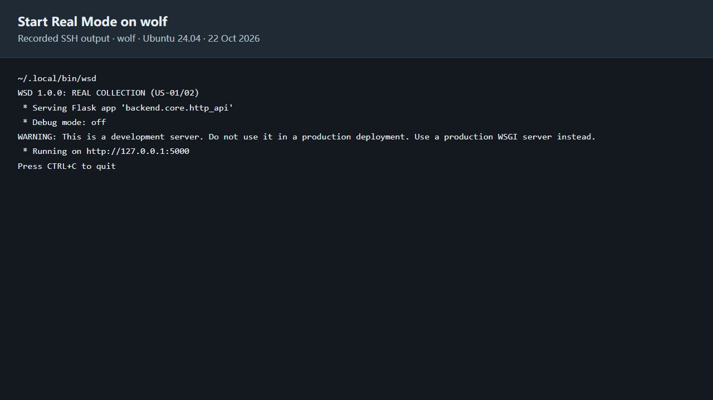

# WSD for Linux

For x86 Linux.

## Install

Extract the downloaded package, then install:

```sh
tar -xzf wsd-1.0.0-linux-x86_64-ubuntu24.04.tar.gz
cd wsd-1.0.0-linux-x86_64-ubuntu24.04
sh install.sh
```

After installation:



## Run

Monitor real disk and process activity:

```sh
~/.local/bin/wsd
```



Or try recommendations using sample data:

```sh
~/.local/bin/wsd --demo
```

On the Linux machine, open http://127.0.0.1:5000/.
Press Ctrl+C to stop before switching modes.

## Frontend walkthrough

See the [frontend walkthrough](../../deliverables/D2/WSD_TA_Frontend_Walkthrough.md)
for the dashboard, recommendations, disk activity and process history.

## Access from another computer

Connect to the Linux machine with port forwarding:

```sh
ssh -L 5500:127.0.0.1:5000 user@host
```

Start WSD in that SSH session. Keep the session open, then visit
http://127.0.0.1:5500/ on your own computer.

## External packages on the Linux host

**Disk and process monitoring** uses `lsblk` from `util-linux` and reads kernel
data from `/proc` and `/sys`. The current Linux backend also imports the BCC
Python bindings (`bcc`) at startup, even when collecting only disk and process
metrics. When running from source, use a Python environment that can import
the distribution's bindings.

**Per-file I/O tracking** also needs headers matching the running kernel, a
kernel with BTF and fentry/fexit support, and permission to load eBPF probes.
On Ubuntu 24.04, install the monitoring dependencies on the Linux host with

```sh
sudo apt install util-linux python3-bpfcc "linux-headers-$(uname -r)"
```

**File moves between pooled drives** require a mounted mergerfs pool and the
`mv` command from `coreutils`. Install these packages if you use this feature.

```sh
sudo apt install mergerfs coreutils
```
Follow [official mergerFS installation guide](https://trapexit.github.io/mergerfs/latest/) for installation instruction.

Follow the [WSD mergerfs setup instructions](https://github.com/csc301-2026-f/21-WSD-Team/blob/156c386e57bf7b11646a23c089ed3aea137d57e7/backend/linux/mergerfs_setup.txt) for drive order, mount options, and how to prepare a file for moving.

## License and source

WSD's original source is licensed under GNU GPL version 3. New packages include
`LICENSE`, `COPYRIGHT.md`, `SOURCE.md`, `source/wsd-source.tar.gz`, and third-party
notices in `licenses/`. The installer keeps these files beside the installed
program at `<prefix>/lib/wsd/1.0.0/` (default prefix: `~/.local`).

See [third-party license and release checks](THIRD_PARTY_NOTICES.md), including
the matching dependency sources required when distributing a binary release.
