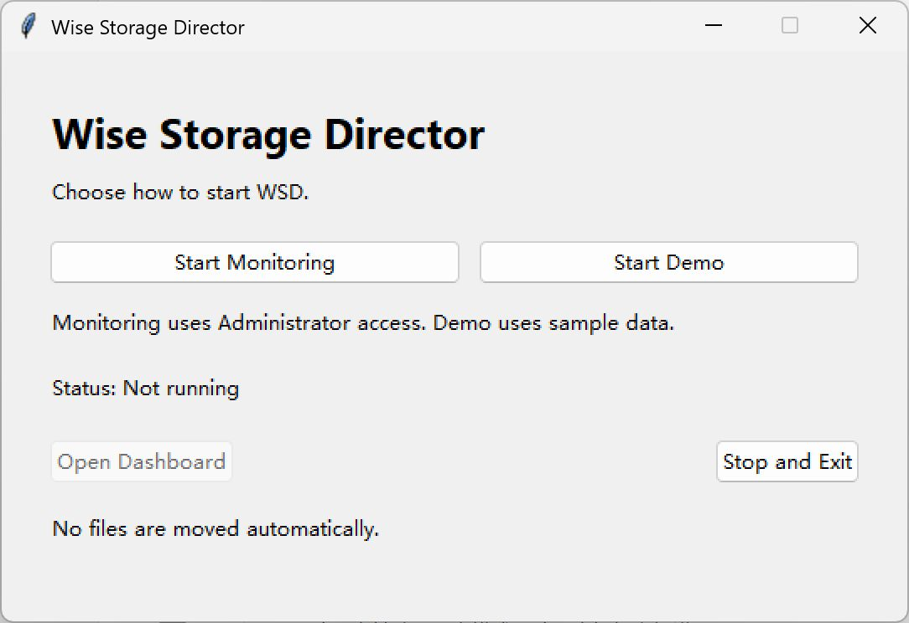
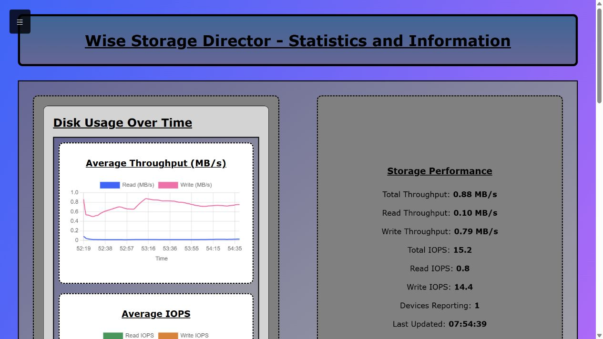
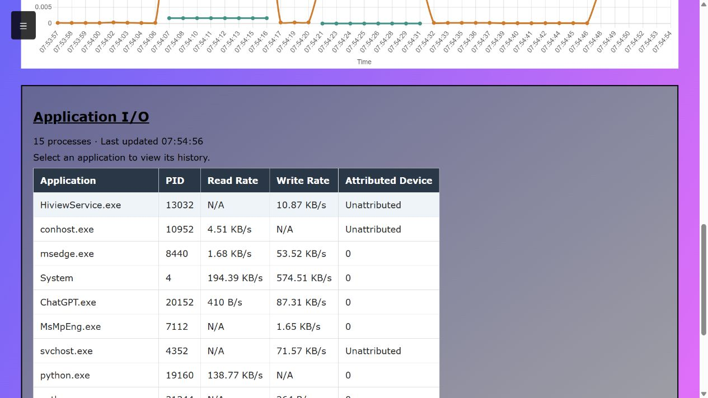
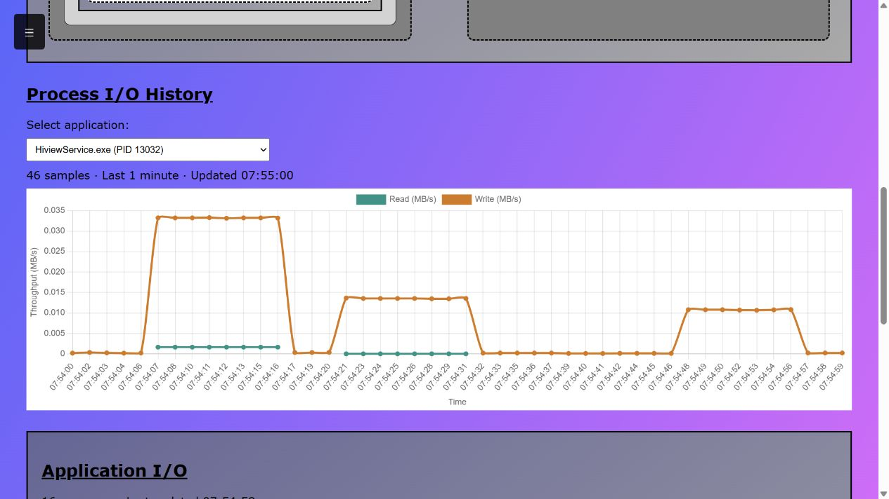

# WSD for Windows

Choose real monitoring or a sample-data demo from an English startup window.

## Run a portable build

Extract `WSD-windows-x86_64.zip`, open the `WSD` folder, and double-click `WSD.exe`.
Keep the `_internal` folder beside the executable.



- **Start Monitoring** collects real Windows activity and requests Administrator access.
- **Start Demo** uses sample data and does not require Administrator access.
- **Open Dashboard** opens the web interface again.
- **Stop and Exit** stops the backend and closes the launcher.

The dashboard opens automatically after startup. To switch modes, click the other
start button; WSD stops the current backend before starting the next one.

History and logs are saved under `%LOCALAPPDATA%\WSD`, separately from the program.

## Run from source

Requires Python 3.10 or newer on Windows.

Open PowerShell in the repository root: the folder containing `backend/` and
`frontend/`. Create a virtual environment and install the dependencies:

```powershell
py -m venv .venv
.\.venv\Scripts\python.exe -m pip install Flask WMI pywin32 pywintrace psutil
```

Start the same launcher:

```powershell
.\.venv\Scripts\pythonw.exe packaging/windows/entrypoint.py
```

Activation is optional. The commands below are also available for direct backend use.

## Run

For real monitoring, open **PowerShell as Administrator**, return to the repository
root, and run:

```powershell
.\.venv\Scripts\python.exe -m backend.main --data-dir .wsd-integration
```

Administrator access is needed to collect Windows disk and file activity.
Keep the terminal open, then visit http://127.0.0.1:5000/ on the same computer.
Press **Ctrl+C** to stop WSD before switching modes.

### Live activity

Open **Disk Usage Statistics** to see disk throughput and operations per second.
The screenshots below show real activity collected on Windows; your values will differ.



Scroll to **Application I/O** for process names, process IDs (PIDs), and read/write rates.



### Process history

Under **Process I/O History**, select an application to view its saved measurements.
Leave WSD running while using other applications to collect more samples.



## Demo mode

To try recommendations using sample data, stop WSD and run:

```powershell
.\.venv\Scripts\python.exe -m backend.main --demo --data-dir .wsd-integration
```

Demo mode does not need Administrator access. Open the same address, go to
**Main Dashboard**, and click **Refresh Recommendations**. These recommendations
use mock file activity, not measurements of your files.

In real mode, a recommendation depends on eligible HDD file activity and available
SSD space; receiving no suggestion can be expected. Neither mode moves files automatically.

## Frontend walkthrough

See the [frontend walkthrough](../../deliverables/D2/WSD_TA_Frontend_Walkthrough.md)
for the dashboard controls and recommendation display.

## Build the portable package

On 64-bit Windows, use a separate Python virtual environment and run:

```powershell
python -m pip install -r packaging/windows/requirements-build.txt
python packaging/windows/build_release.py
```

Output: `dist/windows/WSD-windows-x86_64.zip` and its `.sha256` file.
The package includes Python, dependencies, web resources, WSD source, and license notices.
